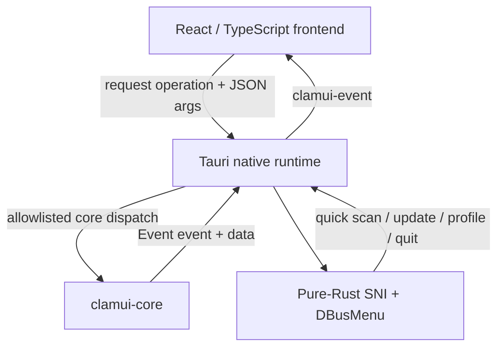

ClamUI is a Rust core plus a Tauri 2 desktop application with a React/TypeScript frontend. The core owns scanning, persistence, scheduling, host integration, and privilege-sensitive behavior; it has no Tauri or GTK widget dependency. The desktop owns WebKitGTK presentation, native dialogs, single-instance forwarding, and the pure-Rust StatusNotifierItem (SNI) tray.

On Linux, GTK application identity opt-in is enabled with the canonical public ID `io.github.linx_systems.ClamUI`, preserving the official desktop-file and logo association. It is separate from Tauri's private bundle identifier.



## Responsibilities

| Component | Responsibility |
| --- | --- |
| `crates/clamui-core` | Headless domain dispatch, XDG persistence, ClamAV host commands, scheduler, quarantine, i18n, and helper protocol |
| `desktop/src-tauri` | Tauri commands, event bridge, native dialogs, safe external/path opening, single instance, lifecycle, and SNI tray |
| `desktop/src` | React pages, navigation, i18n rendering, notifications, and typed frontend API |
| `/usr/bin/clamui-apply-preferences` | Native privileged helper implementing the authenticated protocol-v4 host-configuration boundary |

## Localization and credits

`po/LINGUAS` names the nine shipped gettext catalogs: `de`, `en`, `es`, `fr`, `hu`, `it`, `nb`, `pt_BR`, and `zh_CN`. The Rust core supplies the selected catalog and its plural rule to the CLI, tray, and frontend; catalog extraction, loading, and packaging have no Python runtime dependency.

The root [`AUTHORS`](https://github.com/linx-systems/clamui/blob/master/AUTHORS) file is the canonical contributor list. The Rust build embeds it so every package can render About contributor credits offline, in the file's exact order. About shows translator credits only when the active catalog contains genuine contributor names; the literal `translator-credits` message is not a credit.

## Request and event boundary

The frontend has one asynchronous request path:

```ts
request<T>(operation: string, args?: Record<string, unknown>): Promise<T>
```

The native `request` command routes only allowlisted core operations. There is no frontend filesystem, shell, process, arbitrary command, remote-navigation, or generic IPC permission. Operations use names such as `scanner.scan`, `updater.update`, `quarantine.restore`, and `settings.update`.

All runtime notifications share one event shape and one channel:

```ts
type ClamUIEvent = { event: string; data: unknown }
// Tauri event channel: "clamui-event"
```

Important scan and update events include `scan-progress`, `scan-complete`, `update-progress`, and `update-complete`. The frontend must unsubscribe listeners when unmounted. Long-running requests execute off the Tauri UI thread; cancellation is scoped to the operation ID and never cancels an unrelated scan.

## Native tray

The tray is an **in-process pure-Rust** SNI/DBusMenu implementation. It does not start a Python service, does not use a newline-delimited stdin/stdout protocol, and does not depend on `libdbusmenu` or a GTK tray binding.

It publishes the standard StatusNotifierItem and DBusMenu endpoints when a watcher is available. Its menu preserves the live actions: show or hide the window, Quick Scan, Full Scan, saved-profile selection, database update, and Quit. Tray status follows normal/protected, warning, scanning, and threat states. In the normal protected state, the SNI payload carries the bundled official logo rather than asking the host icon theme to find it; that tray payload is separate from the main window's desktop association. If the desktop has no SNI watcher, ClamUI remains fully usable and does not hide a requested file/folder scan window.

GNOME normally needs [AppIndicator Support](https://extensions.gnome.org/extension/615/appindicator-support/) or another SNI watcher; KDE Plasma, Cinnamon, MATE, and Budgie commonly provide one.

## Desktop lifecycle

The native runtime processes CLI arguments before GUI initialization. The seven `clamui` subcommands and `clamui --help` remain headless. For GUI launches, the single-instance handler forwards the working directory, decoded `file://` paths, and multiple selected files. Normal file launches scan every path; `--virustotal` uses only the first file and makes ignored extras visible to the user.

The desktop exposes only native helper commands for choosing paths, saving exports, copying text, opening an explicitly requested existing path, opening approved external URLs, closing the app, and reading startup state. It enforces a strict content-security policy and rejects webview/new-window navigation.

## Host and security boundaries

ClamAV remains a host-owned engine and database. Flatpak invokes host tools through `flatpak-spawn --host`; no package format bundles or pretends to replace ClamAV. The core's private, bounded host-probe runner is reused for read-only host inspections such as Audit checks and the Network socket snapshot, rather than exposing shell or process execution to the frontend. Protected host configuration uses the validated Rust helper, polkit, explicit destination allowlists, and `PKEXEC_UID` ownership checks. The protocol stays compatible with a trusted already-installed v4 helper during upgrades.

Core persistence stays compatible with the current XDG JSON and SQLite layouts. See [configuration](/docs/reference/configuration/) for locations and [development](/docs/contributing/development/) for the full validation and packaging workflow.